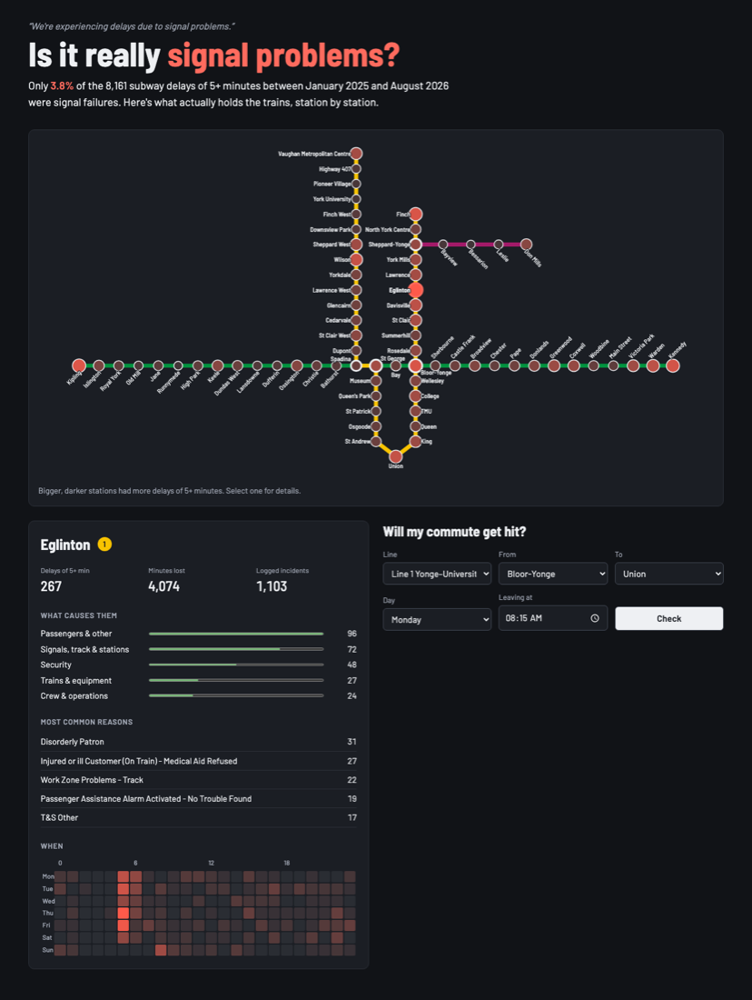
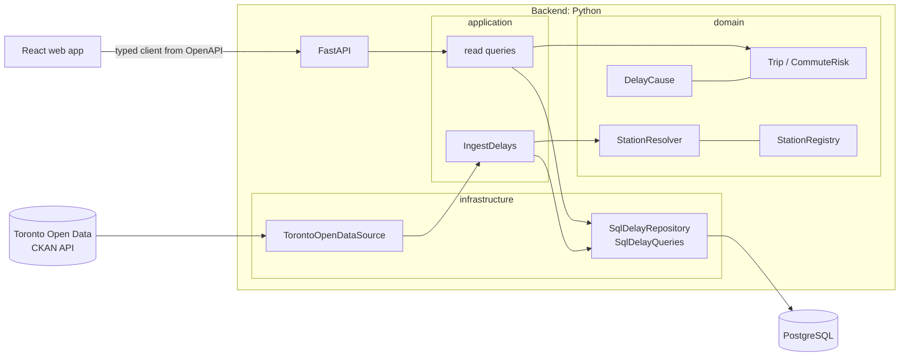

# signal-problems

[](https://github.com/AlanJuker/signal-problems/actions/workflows/backend.yml)
[](https://github.com/AlanJuker/signal-problems/actions/workflows/frontend.yml)
[](https://github.com/AlanJuker/signal-problems/actions/workflows/compose.yml)

> *"We're experiencing delays due to signal problems."*: every Toronto commuter, at least once a week.

**Is it really signal problems?** This project turns the TTC's open subway delay log into a clean dataset, an
API and a web app that answer that question, station by station, and tell you how often your own commute gets
hit.



## What the data says

From the 45,475 incidents logged between January 2025 and August 2026:

- **Only 3.8% of delays of 5+ minutes were actual signal failures** (309 of 8,161). The biggest groups are
  passenger-related incidents (2,712) and security (2,381).
- **Eglinton** had the most 5+ minute delays on Line 1 (267), and 62 of them happened between 5 and 6 a.m.
  On weekdays, 29 of those 55 early delays were track problems, about half of them in work zones, which fits
  overnight track work running into opening time.
- **Kipling → Bloor-Yonge on Friday at 5:30 p.m.** hit a 5+ minute delay on 24 of 87 Fridays (28%).
  Bloor-Yonge → Union on Monday at 8:15 a.m. did on only 4 of 87 Mondays (4.6%).
- **It's getting worse on that Friday trip:** across 2014–2026 it was hit on 77 of 661 Fridays (11.6%), less
  than half the recent rate. Over the whole history, signal failures account for 3.6% of the 44,189 delays of
  5+ minutes.

## Why this is harder than it looks

The `Station` column is free text typed by operators into a field that cuts off at 22 characters: **1,251
distinct spellings for 70 stations**.

| Raw value | What it actually is |
|---|---|
| `BLOOR STATION`, `YONGE BD STATION` | Bloor–Yonge, Line 1 and Line 2 platforms |
| `DUNDAS STATION`, `TMU STATION` | the same station, before and after its renaming |
| `PIONEER VILLAGE STATIO` | truncated at 22 characters |
| `KENENDY STATION` | typo |
| `FINCH TO ST CLAIR` | a segment, not a station |
| `GREENWOOD YARD` | a yard, not a passenger station |

The resolver classifies **99.3% of rows** (94.5% to a specific station) and covers all 70 stations. What it
can't match with confidence stays *unresolved* instead of being guessed. See
[ADR 0002](docs/adr/0002-station-resolution.md).

## Architecture



The backend follows clean architecture ([ADR 0001](docs/adr/0001-clean-architecture.md)). The **domain** (station
resolution, delay causes, commute windows) has no framework imports. **Application** use cases talk to ports
defined as `Protocol`s. **Infrastructure** implements them with SQLAlchemy and httpx. **FastAPI** is the
composition root. Domain and application tests use in-memory fakes and run in milliseconds.

Some decisions worth a look:

- **Idempotent imports by content.** The portal's `_id` is a datastore row number, so each row is keyed by a
  hash of its fields and inserted with `ON CONFLICT DO NOTHING`. The 66 rows logged twice are reported, not
  hidden.
- **The commute check leads with a historical frequency**: *on how many of the observed Mondays was there a
  5+ minute delay on these stations in this window?* It is easy to explain and to verify. Once the delay model is
  trained, its chance for the next Monday sits next to it. Training stores a week of forecasts in the database, so
  the API never loads scikit-learn.
- **One API contract.** The frontend's TypeScript types are generated from the backend's OpenAPI schema, and CI
  fails if they drift apart.
- **Accessible map.** Every station is a keyboard-operable button whose name includes its delay count, so colour
  is never the only signal.

## Stack

| | |
|---|---|
| Backend | Python 3.12, FastAPI, SQLAlchemy 2, Alembic, PostgreSQL, httpx, uv |
| Frontend | React 19, TypeScript, Vite, TanStack Query, openapi-fetch |
| Quality | pytest, Vitest, Testing Library, MSW, mypy (strict), ruff, oxlint, Prettier |
| Delivery | Docker Compose, nginx, GitHub Actions, Dependabot |

## Run it

With Docker:

```bash
make up        # PostgreSQL, API and web app → http://localhost:8080
make ingest    # download the current delay log from Toronto Open Data (~5 s)
make ingest-history   # add 2014–2024 as well: 268,000 rows (~40 s)
make model     # optional: train the delay model and store next week's forecasts (~10 s)
```

API docs are at http://localhost:8000/docs.

Without Docker (SQLite):

```bash
cd backend
uv sync
uv run alembic upgrade head
uv run signal-problems ingest            # add --history for 2014–2024
uv run --group ml signal-problems train-model   # optional: the delay model
uv run uvicorn signal_problems.api.app:app --reload

cd ../frontend
npm install
npm run dev    # http://localhost:5173, proxies /api to :8000
```

## Tests and CI

`make check` runs everything CI runs:

- **Backend:** ruff, mypy `--strict`, and 128 pytest tests at 99% coverage. Integration tests run against
  PostgreSQL 17 in CI and SQLite locally. Warnings fail the build.
- **Frontend:** `tsc`, oxlint, Prettier, and Vitest with Testing Library and MSW at 98% coverage, plus a
  production build.
- **Contract:** CI regenerates the OpenAPI schema and TypeScript types and fails if they differ from the
  committed ones.
- **Compose:** CI builds the images, starts the full stack, loads a fixture and calls the API through nginx.

CI has already caught two real bugs: `rowcount` returning `-1` on PostgreSQL for batched inserts, and a database
connection the CLI never closed. Both are described in their pull requests.

## Project layout

```
backend/
  src/signal_problems/
    domain/          # stations, resolver, causes, delays, commute windows
    application/     # ingest use case, read queries, ports
    infrastructure/  # Toronto Open Data client, SQLAlchemy
    api/             # FastAPI app and HTTP schemas
  migrations/        # Alembic
frontend/
  src/
    api/             # generated types, client, query hooks
    features/        # map, station panel, commute check, hero
docs/adr/            # architecture decision records
```

## Roadmap

- [x] Station resolver, ingestion, API, web app, Docker Compose
- [x] Commute delay model evaluated against the historical frequency: it wins on held-out 2025–2026 data, by a
      modest margin ([write-up](docs/experiments/commute-model.md))
- [x] Serve the model's probability in the commute check, next to the frequency
- [x] Historical data back to 2014: 268,000 rows, 99.7% resolved by the same resolver
- [x] Choose the period every view is based on, kept in the URL
- [ ] Bus and streetcar delay logs
- [ ] Deployment

## Data

Contains information licensed under the
[Open Government Licence – Toronto](https://open.toronto.ca/open-data-license/). Not affiliated with the TTC.

## License

[MIT](LICENSE)
